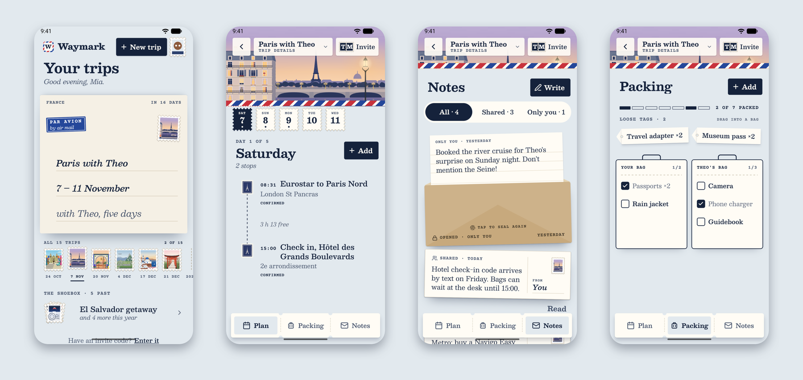
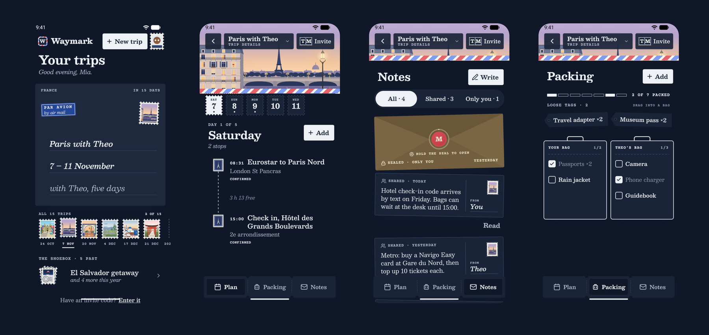

# Waymark

[](https://github.com/ChutLuis/waymark/actions/workflows/ci.yml)

A shared trip planner for two, built as a real product rather than a demo:
Expo and React Native on iOS, Android and web, Supabase with tested Row Level
Security, and a hand-made "Airmail" design where every change of state happens
to paper: trips are dealt like envelopes, stops get stamped and postmarked,
private notes are sealed with wax, and full bags get stamped PACKED.



<table>
  <tr>
    <td width="300"></td>
    <td>
      <strong>Walkthrough</strong> (Android, recorded on the emulator)
      <ol>
        <li>Home deals the picked trip like an envelope from a rail of stamps.</li>
        <li>The card expands into the trip; its destination scene heads the screen.</li>
        <li>Plan lays stops out by clock time; tapping a stop stamps it.</li>
        <li>Packing: drag a loose tag into a bag; a full bag is stamped PACKED.</li>
        <li>Notes: hold the wax seal to open a private letter; tap to seal it again.</li>
        <li>The Trip page prints a sheet of day stamps and a registered-mail invite.</li>
        <li>Past trips live in the shoebox album, postmarked by year.</li>
      </ol>
    </td>
  </tr>
</table>



## What it does

A small group (starting with two people) plans a trip together. Members share
an itinerary and a packing list, and each can keep private notes no other
member can read. Invites are 8-character codes minted by the server.
Reminders are local notifications. Everything works from one Expo codebase on
iOS, Android and web.

## What it demonstrates

- **Supabase done properly.** Postgres Row Level Security on every table,
  privileged writes only through reviewed `security definer` RPCs, and a pgTAP
  suite (104 assertions in 11 files) that proves private-versus-shared
  isolation and the database rules: RPC-only trip and invite creation, owners
  who can't orphan a trip, throttled and expiring invites, and resumable
  account deletion through an Edge Function. See `docs/SECURITY.md`.
- **Production React Native.** Expo SDK 57, React Native 0.86 on the New
  Architecture, Reanimated 4 worklets for all motion, TanStack Query with an
  offline queue, typed Supabase access, and native notifications on an
  Android channel.
- **Deliberate design.** A complete design system (tokens, type roles,
  contrast-checked palettes in light and dark) and a motion spec implemented to
  the frame. It honours Reduce Motion and screen readers, and holds up at 200%
  text. See `docs/DESIGN_DECISIONS.md`.
- **A complete delivery.** Migrations, Vitest and pgTAP gates in CI, local EAS
  builds in three variants that install side by side, and a release AAB checked
  for permissions, signing and 16 KB page alignment (`docs/BUILDS.md`).

## Tech

Expo SDK 57 · React Native 0.86 (New Architecture) · TypeScript · Expo Router ·
Reanimated 4 · TanStack Query · React Hook Form + Zod · Lottie · Supabase
(Postgres, Auth, Storage, Edge Functions) · pgTAP · Vitest · EAS Build.

## Running it

```
cp .env.example .env   # fill with the local values printed by `supabase start`
supabase start         # local Postgres + Auth + Storage
pnpm install
pnpm android           # build + install the dev client (app.waymark.dev)
adb reverse tcp:54321 tcp:54321   # the device reaches the local Supabase
pnpm start:dev-client  # Metro for the installed dev client
pnpm web               # Expo web
```

The app uses native modules Expo Go doesn't ship, so it runs as a development
build.

Quality gates (all green):

```
pnpm typecheck         # TypeScript
pnpm lint              # ESLint, 0 errors / 0 warnings
pnpm test              # Vitest, 611 tests (pure logic)
supabase test db       # pgTAP, 104 assertions (RLS and RPCs)
```

Android release builds run locally with `eas build --local`
(`development`, `test`, `production` and `production-apk` profiles); see
`docs/BUILDS.md` for the toolchain, signing and artefact checks.

## Status

v1 is feature-complete against a live Supabase backend: email auth and
onboarding, trips, itinerary, packing, shared and private notes, invite
codes, local reminders, offline handling, covers and avatars, password reset
and in-app account deletion. Before a store release the remaining steps are
operational: final app name and id, hosted backend migrations and auth
settings, publishing the privacy pages, the Play Console listing, and an iOS
build (which needs macOS).

## Documentation

- `docs/REQUIREMENTS.md` - product vision, scope and success criteria.
- `docs/ARCHITECTURE.md` - stack, structure, data model, data access, testing.
- `docs/SECURITY.md` - authentication, the RLS model and its test matrix.
- `docs/DESIGN_DECISIONS.md` - the design system and the decisions behind it.
- `docs/ONBOARDING.md` - developer orientation and change workflow.
- `docs/BUILDS.md` - build profiles, environment values, signing and release checks.

## Non-goals for v1

Maps and geosearch, in-app chat, real-time collaborative editing, AI features,
payments and subscriptions, offline write sync with conflict resolution, and
social feeds.
